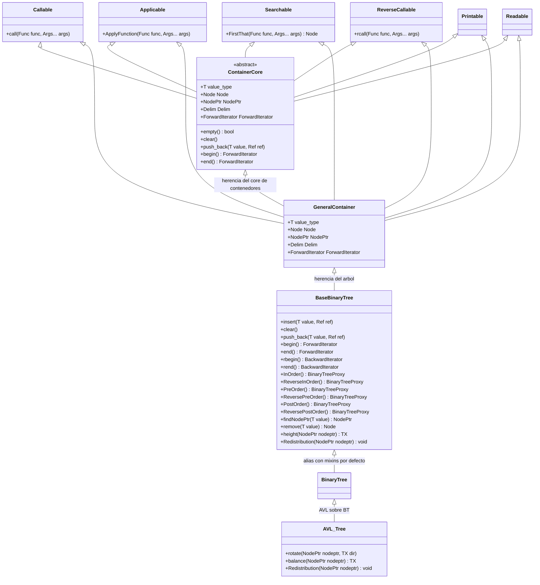
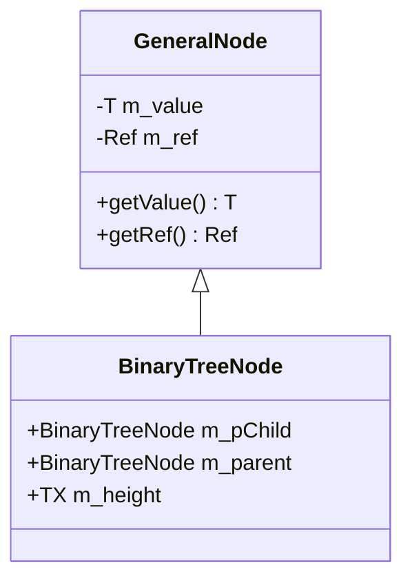
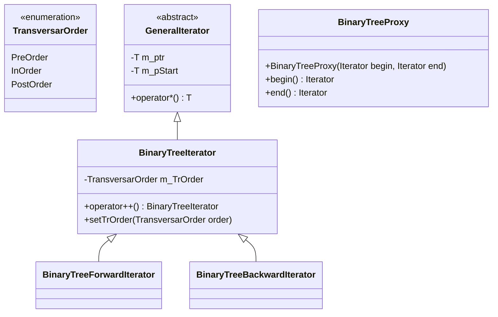
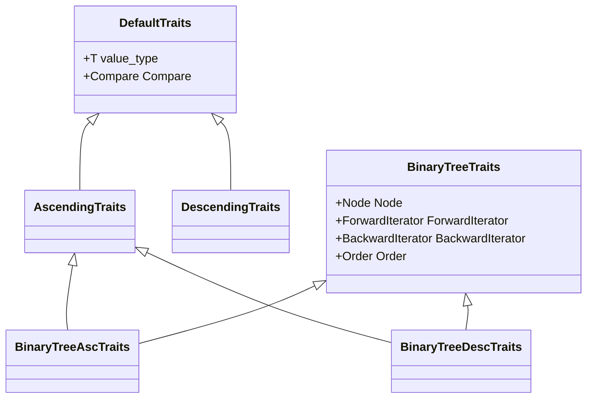

# Diagramas de clases

Diagramas de clases en **Mermaid** para el código C++ del proyecto, con foco en el **BinaryTree**, el contenedor **AVL_Tree** y sus clases padres, así como para los **iteradores** y los **traits** (tipos de datos que describen la estrategia de recorrido y comparación de cada contenedor).

## 1. BinaryTree, AVL_Tree y sus padres

## 2. Nodo del BinaryTree

## 3. Iteradores del BinaryTree

## 4. Traits del BinaryTree

## Fuentes

- `containers/binarytree.h`
- `containers/AVLtree.h`
- `containers/GeneralContainer.h`
- `containers/ContainerCore.h`
- `containers/mixins.h`
- `containers/GeneralIterator.h`
- `containers/GeneralNode.h`
